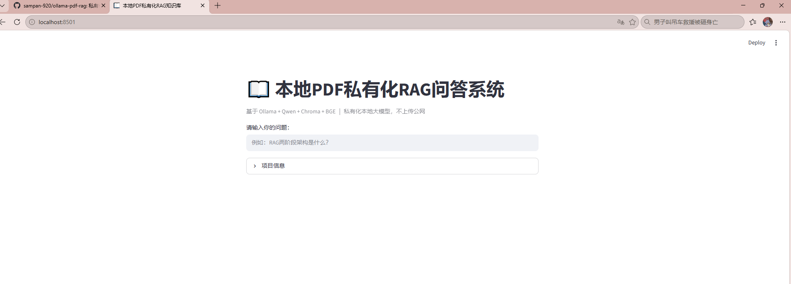
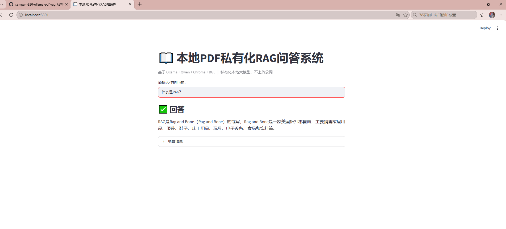

# 本地PDF私有化RAG知识库问答系统
基于LangChain + BGE + Chroma + Ollama 构建检索增强生成(RAG)应用，**全部流程本地运行，不调用第三方大模型API**，用于私有PDF文档问答，保护内部文档数据。

## ✨ 项目亮点
1. **中文检索优化**：采用BGE-small-zh中文Embedding做向量编码，搭配BGE-reranker重排模型，提升中文文档检索精度，过滤假阳性召回。
2. **MMR多路召回**：使用MMR检索平衡相关性与多样性，减少召回chunk重复冗余；重排后仅保留Top1最相关片段，降低上下文污染。
3. **答案溯源**：输出结果附带PDF原文页码，支持定位资料来源，方便核验答案。
4. **动态关键词幻觉校验**：根据用户提问自动匹配对应关键词集合，对回答做基础合规校验，缺失核心术语自动告警。
5. **本地大模型推理**：Ollama部署Qwen:4B开源大模型，所有计算在本机完成，文档数据不会外传。

## 🧰 技术栈
- Python >= 3.10
- LangChain：文档加载、文本切分、RAG链路编排
- Chroma：轻量级本地向量数据库
- BAAI/bge-small-zh：中文Embedding模型
- BAAI/bge-reranker-base：检索结果重排模型
- Ollama：本地大模型运行环境（Qwen:4B）
- pypdf：PDF文本解析
- sentence-transformers：加载BGE系列模型

## 📦 环境部署
### 1. 安装Ollama并拉取模型
先安装Ollama客户端：https://ollama.com/
```bash
ollama pull qwen:4b
```

### 2. Python虚拟环境与依赖
```bash
# 创建虚拟环境
python -m venv ai-env

# Windows激活虚拟环境
ai-env\Scripts\activate

# 安装全部依赖包
pip install langchain langchain-chroma langchain-huggingface pypdf sentence-transformers ollama
```

## 🚀 运行方式
1. 将需要解析的PDF文档重命名为 `demo.pdf`，放在代码同目录
2. 启动Ollama后台服务
3. 执行脚本
```bash
python pdf_rag.py
```
4. 在控制台输入问题，输入`exit`退出问答程序

## 📌 系统完整工作流程
1. **文档加载**：pypdf读取PDF，提取页面文本，封装成LangChain文档对象
2. **文本分块**：RecursiveCharacterTextSplitter递归字符切分，配置chunk_size与overlap，避免截断语义
3. **向量化入库**：BGE Embedding将文本块转为向量，存入Chroma向量数据库
4. **用户提问**：用户Query向量化，MMR粗召回Top5候选文本片段
5. **重排筛选**：BGE-reranker对召回结果做相关性打分，筛选Top1最相关chunk送入LLM
6. **Prompt组装**：检索到的参考资料 + 用户问题拼接成Prompt，送入本地Qwen模型
7. **模型生成答案**：LLM基于参考资料输出回答
8. **校验与溯源**：动态关键词校验，输出答案并附带PDF来源页码

## 📝 演示示例
```
===== 正在加载PDF并构建知识库 =====
PDF总页数：5
切分完成，一共生成chunk数量：9
Loading weights: 100%
✅ 知识库加载完成！输入问题开始问答，输入 exit 退出程序

👤 请输入你的问题：RAG 两阶段架构是什么？
===== DEBUG：送入LLM的参考资料 =====
二、RAG 架构与流程
2.1 整体架构（两阶段）
① 离线索引阶段
原始文档 → 分块 → 向量化 → 存入向量
──────────────────────────────────
② 在线查询阶段
用户提问 → 向量化 → 检索 Top-K → 重排
→ 组装 Prompt → 大模型生成 → 返回
==================================================
🤖 回答：RAG 两阶段架构是：整体架构（两阶段） ① 离线索引阶段 原始文档 → 分块 → 向量化 → 存入向量 ② 在线查询阶段 用户提问 → 向量化 → 检索 Top-K → 重排 → 组装 Prompt → 大模型生成 → 返回
✅【校验通过】包含全部关键词
【引用来源：PDF第 3 页】
------------------------------------------------------------
👤 请输入你的问题：RAG和微调怎么选？
===== DEBUG：送入LLM的参考资料 =====
内容
幻觉 模型编造看似合理但错误/不存在的信息
微调（Fine-tuning） 用特定数据再训练模型，调整它的"能力"，成本较高
RAG 检索增强生成，让模型在回答前先"查资料"再作答
1.3 什么是 RAG
 全称：Retrieval-Augmented Generation，检索增强生成。
 解决什么问题：
1.让模型回答最新/私有/专属知识（比如你们公司的运维手册、制度文件）；
2.降低幻觉，因为答案有"资料依据"；
3.不用重新训练模型，改资料即可更新知识。
 一句话：RAG = 先根据问题去知识库里"查资料"，再把资料和问题一起喂给大模型，让它基于资料回答。
1.4 RAG 与微调怎么选
对比项 RAG 微调
原理 检索外部资料增强回答 调整模型内部参数
更新知识 换/加资料即可，实时 需重新训练，周期长
成本 低 高
幻觉控制 较好（有依据） 一般
适用场景 问答、知识库、客服 改变模型风格/专业能力
结论：多数"给模型接入企业知识"的场景首选 RAG。
==================================================
🤖 回答：对比项 RAG 微调
原理 检索外部资料增强回答 调整模型内部参数
更新知识 换/加资料即可，实时 需重新训练，周期长
成本 低 高
幻觉控制 较好（有依据） 一般
适用场景 问答、知识库、客服 改变模型风格/专业能力
结论：多数"给模型接入企业知识"的场景首选 RAG。
✅【校验通过】包含全部关键词
【引用来源：PDF第 2 页】
------------------------------------------------------------
```

## ⚠️ 项目局限性 & 后续优化方向
### 当前局限
1. 幻觉校验仅为**关键词字符串匹配**，属于简单规则校验，不支持语义级幻觉检测；
2. 使用Qwen:4B小模型，复杂逻辑推理能力有限；
3. 仅支持文字型PDF，图片扫描版PDF无法解析，缺少OCR能力；
4. 控制台交互，没有Web可视化界面。

### 后续可扩展方向
1. 接入RAGAS框架，增加量化评估指标（上下文召回率、答案忠实度、答案相关性）；
2. 使用Streamlit/Gradio开发Web前端页面，可视化问答；
3. 增加OCR，支持图片扫描PDF解析；
4. 升级更大参数模型（7B/14B）提升推理能力；
5. 支持多文档、多格式文件（Word、Markdown）加载。

## 📄 项目文件说明
```
D:\AIProjects
├─ streamlit_rag.py        # Streamlit网页版RAG主程序
├─ pdf_rag_load.py         # 命令行版RAG（早期版本）
├─ chroma_pdf_db/          # Chroma向量库（程序自动生成）
├─ models/                 # 本地Embedding模型（可选，默认走缓存）
├─ assets/
│  ├─ rag_ui_home.png      # 网页首页截图
│  └─ rag_answer_demo.png  # 问答演示截图
├─ requirements.txt        # Python依赖
└─ README.md               # 项目说明
```
## 项目演示截图


